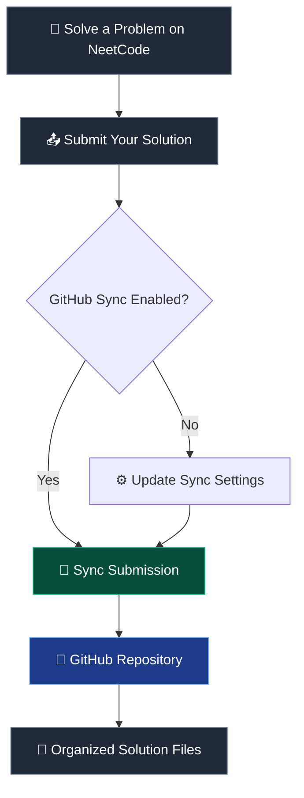

# ⚡ NeetCode Solutions

<p align="center">
  
  
  
</p>

<p align="center">
  <b>A growing collection of coding interview solutions, algorithmic patterns, and problem-solving practice.</b>
  <br />
  Automatically synchronized from <a href="https://neetcode.io">NeetCode.io</a> to GitHub.
</p>

<p align="center">
  <a href="https://neetcode.io/profile/github">NeetCode Sync Settings</a> ·
  <a href="https://github.com/chanu2005-wq">GitHub Profile</a> ·
  <a href="https://neetcode.io">Practice Problems</a>
</p>

---

## 🧭 Navigation

<p align="center">
  <a href="#-overview">Overview</a> •
  <a href="#-repository-structure">Structure</a> •
  <a href="#-languages">Languages</a> •
  <a href="#-github-sync">GitHub Sync</a> •
  <a href="#-settings">Settings</a>
</p>

---

## 🎯 Overview

Welcome to my **NeetCode Solutions Repository**!

This repository contains my coding submissions synced through the NeetCode GitHub integration. It serves as a centralized place to explore my solutions and track my ongoing practice in data structures and algorithms.

<table>
  <tr>
    <td align="center" width="33%">
      <h3>🧠</h3>
      <b>Problem Solving</b>
      <br />
      <sub>Practice algorithms and coding patterns</sub>
    </td>
    <td align="center" width="33%">
      <h3>🚀</h3>
      <b>Interview Prep</b>
      <br />
      <sub>Build technical interview readiness</sub>
    </td>
    <td align="center" width="33%">
      <h3>🔄</h3>
      <b>Auto Sync</b>
      <br />
      <sub>Keep submissions backed up on GitHub</sub>
    </td>
  </tr>
</table>

---

## 📂 Repository Structure

Solutions are organized by topic, followed by the problem identifier and individual submission files.

```text
neetcode-submissions/
│
├── Data Structures & Algorithms/
│   ├── two-integer-sum/
│   │   └── submission-0.py
│   │
│   └── binary-search/
│       └── submission-0.ts
│
├── Python For Beginners/
│   └── python-hello-world/
│       └── submission-0.py
│
└── README.md
```

> **Note:** This is an illustrative example. The actual folders and files depend on the submissions synchronized from NeetCode.

### 📌 Submission naming convention

| File pattern | Description |
|---|---|
| `submission-0.py` | First Python submission |
| `submission-1.py` | Second Python submission |
| `submission-0.js` | First JavaScript submission |
| `submission-0.cpp` | First C++ submission |

Each problem can contain multiple submissions, depending on your sync history.

---

## 💻 Languages Supported

The repository can contain solutions in multiple programming languages.

<p>
  
  
  
  
  
  
  
  
  
  
  
</p>

| Language | Extension |
|---|---|
| Python | `.py` |
| JavaScript | `.js` |
| TypeScript | `.ts` |
| Java | `.java` |
| C++ | `.cpp` |
| C# | `.cs` |
| Go | `.go` |
| Rust | `.rs` |
| Kotlin | `.kt` |
| Swift | `.swift` |
| SQL | `.sql` |

---

## 🔄 GitHub Sync Workflow

The NeetCode GitHub integration helps keep this repository synchronized with your coding submissions.



### ⚙️ How to synchronize submissions

1. Open [NeetCode GitHub Settings](https://neetcode.io/profile/github).
2. Connect your GitHub account if it is not already connected.
3. Enable automatic commits and choose your preferred submission status filter.
4. Use **Bulk Sync** to synchronize previous submissions.
5. Use the submission history panel to manage individual submissions when supported.

---

## 🛠️ Sync Settings

Manage your repository synchronization preferences through NeetCode.

| Setting | Purpose |
|---|---|
| **Auto-commit** | Automatically synchronize new submissions |
| **Status Filter** | Choose which submission statuses to sync |
| **Bulk Sync** | Synchronize existing submissions in bulk |
| **Individual Sync** | Sync or remove specific submissions where supported |
| **Repository Management** | Rename the connected repository or start a new one |

**Configure your settings:** [neetcode.io/profile/github](https://neetcode.io/profile/github)

---

## 📈 My Learning Approach

I use coding practice to strengthen the fundamentals needed for software engineering and technical interviews.

- 🧩 **Understand:** Identify the core problem and constraints.
- 🔍 **Analyze:** Explore possible approaches and edge cases.
- ⚡ **Optimize:** Improve time and space complexity where possible.
- 🧪 **Validate:** Test solutions against examples and edge cases.
- 🔁 **Review:** Revisit problems to improve implementation and recall.

---

## 🌐 Useful Resources

| Resource | Description |
|---|---|
| [NeetCode](https://neetcode.io) | Curated coding interview problems and explanations |
| [NeetCode Roadmap](https://neetcode.io/roadmap) | Explore core interview topics and problem patterns |
| [GitHub Profile](https://github.com/chanu2005-wq) | Explore my repositories and development work |
| [LeetCode](https://leetcode.com) | Additional coding challenges and practice |

---

## 📌 Important Notes

- This repository is maintained through the NeetCode GitHub integration.
- The number of solutions and languages depends on synchronized submissions.
- Submission files may contain multiple attempts at the same problem.
- The repository is intended for learning, revision, and interview preparation.
- For the latest synchronization behavior and available options, refer to the official [NeetCode GitHub settings](https://neetcode.io/profile/github).

---

<p align="center">
  <b>Consistency beats intensity. One problem at a time. ⚡</b>
  <br />
  <sub>Built through practice · Powered by NeetCode · Synced with GitHub</sub>
</p>
